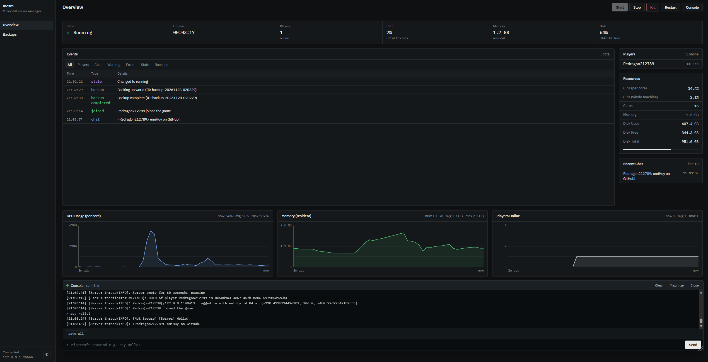

# mc-server-manager

Running a self-hosted Minecraft server often means juggling a terminal, SSH session, or remote desktop just to check status, restart the server, watch logs, or create backups.

mc-server-manager is a lightweight manager for a self-hosted Minecraft server. It runs the server, tracks its state, console, players, and resource use, and makes them available through a web dashboard, a CLI, and an HTTP API. It is designed to sit alongside a single server on a trusted machine.



## Features

- Start, stop, and kill the server
- Live console and commands
- Player tracking, events, and CPU / memory / disk metrics
- Automatic restart after crashes
- World backups with retention, manual or scheduled
- Web dashboard, CLI (`mcsm`), and HTTP API
- Token authentication
- Remote server management through Tailscale

## Requirements

- Go (see `go.mod` for the version)
- Java, and a Minecraft server jar with its EULA accepted
- Windows or Linux

## Quick Start

1. Build the manager and the CLI:
   ```
   go build
   go build -o mcsm ./cmd/mcsm
   ```
2. Copy `config/config.example.toml` to `config/config.toml` and set at least the required fields. See [Configuration](docs/configuration.md) for more details.
3. Run it from the project's root folder:
   ```
   ./mc-server-manager
   ```
4. Manage the server through the dashboard, the CLI, or the HTTP API. See [Usage](#usage) below.

Press Ctrl+C to stop. The manager asks the server to save and exit. A second Ctrl+C kills it.

## Usage

The manager serves everything on the address set by `api.host` and `api.port` in your config. There are three ways to use it:

- **Dashboard:** a web UI for status, console, players, and controls. Open `/dashboard` on the manager's address in a browser.
- **CLI (`mcsm`):** control the server from a terminal. Run `mcsm help` for all commands. Point it at the manager with `--addr` or the `MCSM_ADDR` environment variable, and give it your token with `MCSM_TOKEN`. See [CLI](docs/cli.md) for more details.
- **HTTP API:** for scripts and other tools. Interactive docs are at `/docs` on the manager's address.

## Remote access

To reach the manager from another device, set `api.host` to `"tailscale"` (or `"0.0.0.0"`) in your config.

A token is **required** for any host other than loopback, so set an `api.token` too. Generate one with `./mc-server-manager token`, and give it to the CLI through `MCSM_TOKEN`.

The API is plain HTTP, so a token can be seen by anyone sniffing the network. Only expose the manager on networks you trust.

## Releases

See [CHANGELOG.md](CHANGELOG.md) for release history.

## Documentation

- [Architecture](docs/ARCHITECTURE.md)
- [CLI](docs/cli.md)
- [Configuration](docs/configuration.md)
- [Troubleshooting](docs/troubleshooting.md)
- [Changelog](CHANGELOG.md)


## Possible Future Additions

- TLS support
- `server.properties` editing
