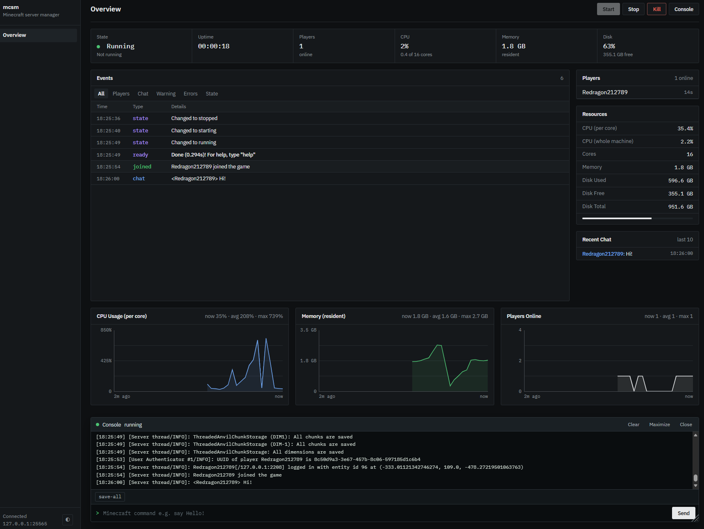

# mc-server-manager

A lightweight manager for a self-hosted Minecraft server. Runs on the host machine and enables remote administration through a web dashboard, CLI, and HTTP API.



## Features

- Control server lifecycle (start, stop, kill)
- Live console and command sending
- Player tracking and events (joins, leaves, chat, warnings, errors)
- CPU, memory, and disk metrics
- Web dashboard, CLI (`mcsm`), and API
- Optional bearer-token authentication

## Requirements

- Go (see `go.mod` for the version)
- Java, and a Minecraft server jar with its EULA accepted
- Windows or Linux

## Build and run

```
go build
./mc-server-manager
```
Then open the dashboard at <http://127.0.0.1:8080/dashboard> (the default address; see `api.host` and `api.port` below). Press Ctrl+C to stop: the manager asks the server to save and exit, and a second Ctrl+C kills it.

To build the CLI:
```
go build -o mcsm ./cmd/mcsm
```

## Configuration

Copy `config/config.example.toml` to `config/config.toml` and edit it.

| Key | Notes |
|---|---|
| `minecraft.*` | Server directory, jar, and memory settings. |
| `minecraft.autostart` | Start the server when the manager starts. |
| `api.host`, `api.port` | Default `127.0.0.1:8080`. Use `0.0.0.0` to allow other machines. |
| `api.token` | Optional, at least 16 characters. You can generate one with `./mc-server-manager token`. |

## CLI

```
  mcsm status
  mcsm start --wait
  mcsm command say hello
  mcsm logs -f
```
Run `mcsm help` for all commands. Set `MCSM_TOKEN` if the manager requires a token, and `MCSM_ADDR` if it isn't at the default `http://127.0.0.1:8080`.

## API

Interactive docs are served at `/docs`. With a token set, send `Authorization: Bearer <token>`.

## Server states

```
stopped -> starting -> running -> stopping -> stopped
                |          |          |
                +----------+----------+--> crashed
```

`starting` lasts until the console prints its "Done" line.

## Known limitations

- The API is plain HTTP, so the token is visible to anyone sniffing the network. With no token and a non-loopback host, anyone on the network can control the server.
- A slow stream client can miss messages. Re-fetch `/api/server/status` after reconnecting.
- Readiness detection expects vanilla's "Done" line.

## Development

```
go test ./...
go vet ./...
```

## TODO

- Scheduled backups
- Scheduled online/offline hours
- Security hardening (check commands sent, bind to a tailnet address)
- Server properties + config editor
- ESP32 server monitoring
