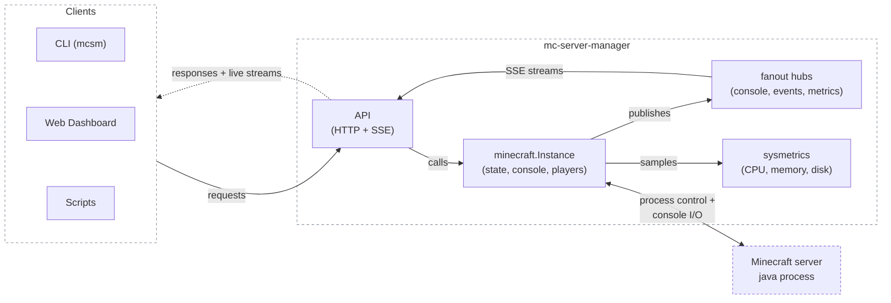
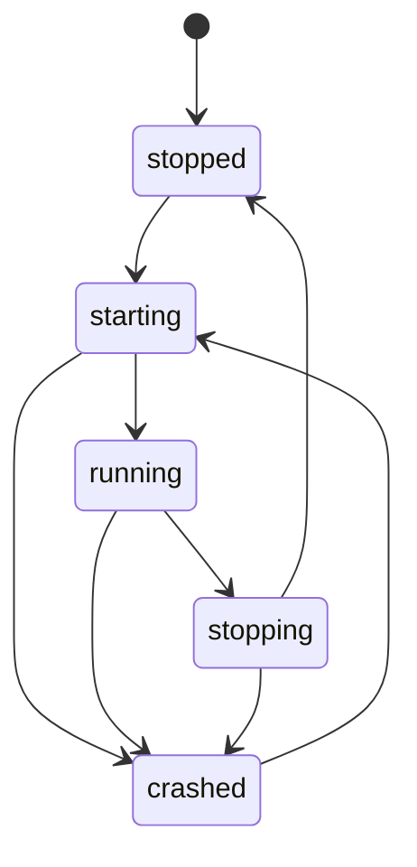

# Architecture

mc-server-manager is one Go binary that supervises one Minecraft server process and exposes it over HTTP. The dashboard, the CLI, and any scripts are all clients of the same API.

## High-Level Overview

## Packages

| Package | Role |
|---|---|
| `main` (repo root) | Entry point and wiring. Loads config, works out the API listen address, creates the `Instance`, the backup scheduler, and the API server, optionally autostarts Minecraft, and handles graceful shutdown on SIGINT/SIGTERM. Also implements `./mc-server-manager token`. |
| `config` | Loads and validates `config/config.toml`, applies defaults. |
| `minecraft` | Owns the Java process. State machine, console commands, event parsing, players, metrics, crash restarts, pre-start checks, and PID file tracking, with per-OS process settings. |
| `backup` | Manages world backups, including scheduled automatic ones. |
| `api` | HTTP server: routes and handlers, bearer-token auth, SSE streaming, error responses. Embeds the web dashboard (`static/`) and the OpenAPI spec and interactive docs (`docs/`). |
| `cmd/mcsm` | The CLI. A plain HTTP client of the API. |
| `internal/fanout` | Generic publish/subscribe hub with a ring buffer of history, used by console, events, and metrics. |
| `internal/sysmetrics` | CPU, memory, and disk sampling. |
| `internal/apitypes` | Request and response types shared by the API and the CLI. |
| `internal/pidfile` | Reading and writing PID files. |
| `internal/portcheck` | Checking whether a TCP port is free. |
| `internal/proc` | Process helpers. |

## The server process (`minecraft.Instance`)

`minecraft.Instance` manages the child Java process lifecycle, console I/O, and state transitions. It is the only thing that touches the Java process. Everything else asks it to act or subscribes to what it publishes.

- **State & lifecycle**: `starting` transitions to `running` once the server logs "Done". Any live state (`starting`, `running`, `stopping`) can transition to `crashed`, which can be restarted via `Start()`.
- **Exit handling**: A watcher goroutine waits on process exit to resolve the final state (`stopped` vs. `crashed`).
- **Shutdown**: `Stop()` sends the `stop` command to stdin and waits up to `stop_timeout` before force-killing; `Kill()` terminates immediately without saving the world.
- **Process I/O**: stdout and stderr are merged into a single pipe read by a parser goroutine that emits events (join, leave, chat, warn, error, ready). Concurrent stdin writes are serialized to prevent command interleaving.
- **Locking**: Uses two mutexes acquired in strict order: state/process mutex → stdin mutex. Fanout hubs manage their own locks and never call back into Instance, so publishing events while holding the state lock is deadlock-free.

## Streams (`internal/fanout`)

Console lines, events, and metrics each go through a `Hub`. A hub keeps a bounded history and gives each subscriber a bounded channel. A slow subscriber drops messages instead of blocking the server; clients that reconnect re-fetch status to resync.

Metrics are only sampled while someone is subscribed.

## HTTP API (`api/`)

- Built on `net/http` with a standard `ServeMux`. Wrong methods get a JSON 405.
- Live data uses Server-Sent Events (SSE). For that reason the server sets a `ReadHeaderTimeout` but no `WriteTimeout`, which would cut every stream. Shutdown cancels the base context so open streams end and the server can stop.
- The dashboard is static HTML, CSS, and vanilla JavaScript embedded in the binary. It reads status from the API and live data from the SSE streams.
- Interactive API docs are served at `/docs`.

## CLI (`cmd/mcsm/`)

The CLI never touches the server directly. It sends HTTP requests to a running manager using the types in `internal/apitypes`, so anything the CLI can do, a script can do too.

## Shutdown

On SIGINT or SIGTERM, `main` asks Minecraft to save and stop. A second signal kills it. An API failure also triggers shutdown.

## Auto Restart

Automatically brings the server back up after a crash or failed start, backing off between attempts so a broken server does not loop endlessly.

- **Smart retries:** Waits longer between each retry (up to a 5-minute cap) and gives up after `max_restarts` attempts, logging an error and leaving the server crashed. A server that stays healthy for 10 minutes resets the failure count.
- **Manual & shutdown safe:** Starting the server manually cancels any pending retry, and shutting down disables auto-restart first so it will not restart while stopping.
- **API control:** Lets you turn auto-restart on or off at runtime and check its status, attempt count, and next scheduled retry.

## Backups

Creates safe world backups on a schedule or on demand without tying backup logic directly to the server implementation.

- **Safe world snapshots:** Pauses auto-saves and flushes pending writes before archiving when the server is running (always re-enabling saves afterward), or archives the world as is when stopped.
- **Crash-safe & bounded:** Writes archives to a temporary file before moving them into place, prunes older archives to keep the latest `keep` backups, and blocks overlapping runs.
- **Scheduled & event-driven:** Supports automatic interval scheduling (skipping scheduled backups when no files have changed), streams backup activity over SSE, and lists or deletes backups by ID rather than file path.

## Design Principles

- **Minecraft comes first.** The manager should stay idle and cheap on low-power hardware.
- **One interface to everything.** The dashboard, the CLI, and scripts all go through the API.
- **Few dependencies.** Standard library wherever practical; no database.
